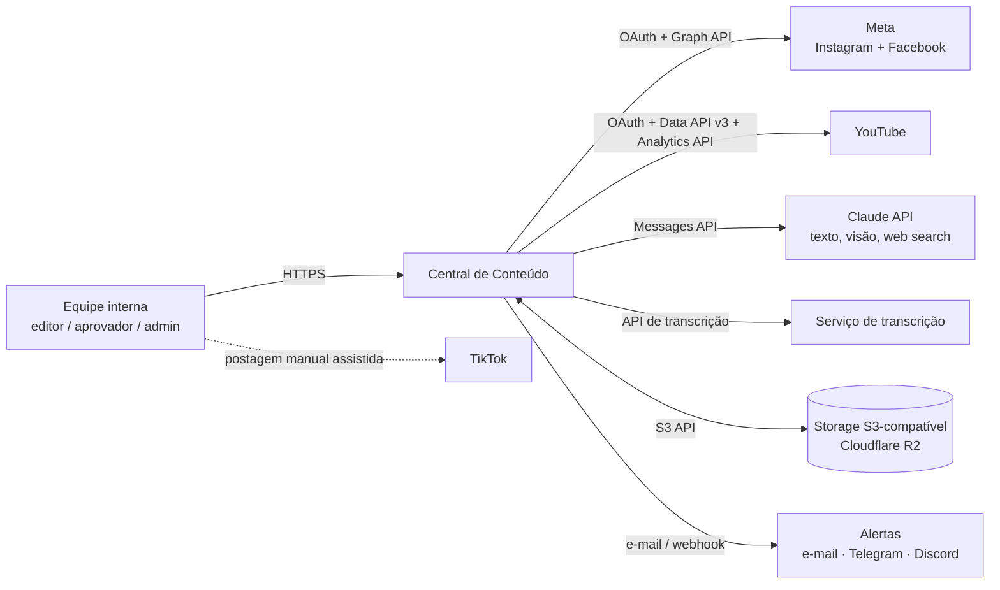
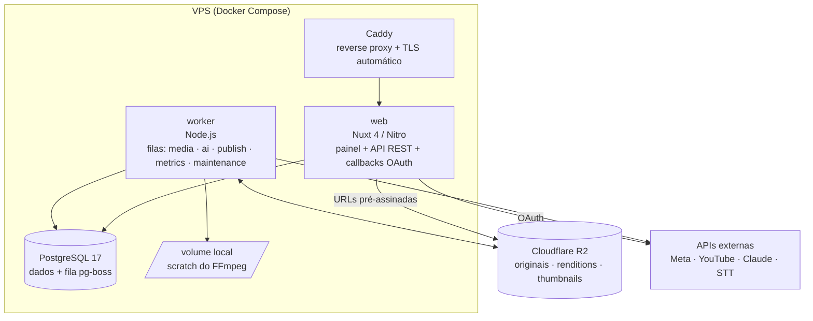
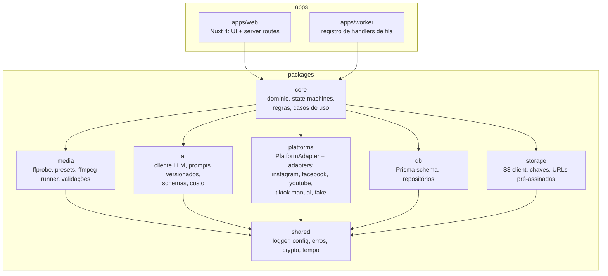
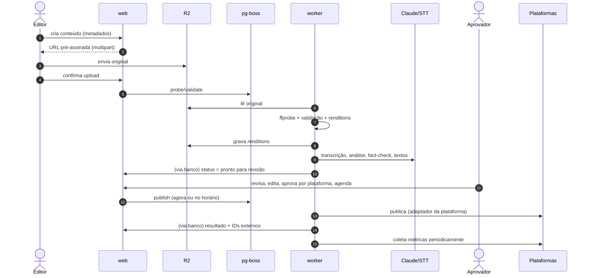

# 03 — Arquitetura proposta

## 1. Abordagens consideradas

| Abordagem | Resumo | Prós | Contras | Decisão |
|---|---|---|---|---|
| **A. Monolito modular TS + worker + fila no Postgres** | Nuxt 4 (painel + API) e um processo worker no mesmo repositório; pg-boss como fila; storage S3; Docker Compose em 1 VPS | Poucas peças; barato; idempotência/retry no código e testáveis; fácil de operar por uma pessoa | Escala vertical no início | ✅ **Escolhida** |
| B. A + Redis/BullMQ | Igual à A com fila em Redis | Rate limiting e prioridades maduros; UI de filas pronta | Mais um serviço para operar/backup; ganho pequeno no volume atual | Evolução documentada (gatilho na §8) |
| C. n8n como orquestrador | Fluxos visuais chamando serviços pequenos | Fluxos visíveis | Idempotência, versionamento, testes e concorrência frágeis justamente no requisito mais crítico | ❌ Descartada para o núcleo |
| D. Serverless (Vercel/Lambda) | Funções + serviços gerenciados | Zero servidor | FFmpeg com arquivos grandes esbarra em limite de tempo/memória/disco | ❌ Descartada |

## 2. Visão de contexto

## 3. Visão de containers (implantação)

- **web** nunca executa trabalho pesado: valida, grava no banco e enfileira.
- **worker** executa todo trabalho assíncrono. Pode ser escalado para N réplicas (pg-boss usa `SKIP LOCKED`), e as filas podem ser separadas em processos distintos no futuro (ex.: worker só de mídia em outra máquina).
- O navegador envia o vídeo **direto ao R2** via URL pré-assinada; o arquivo não passa pelo Node.

## 4. Módulos (monorepo)

**Regra de dependência:** `apps → core → (db, media, ai, platforms, storage) → shared`. Os pacotes `media`, `ai` e `platforms` **não se conhecem** entre si nem conhecem o banco; recebem dados e devolvem resultados. Isso cumpre a separação exigida entre processamento, IA e publicação e permite testá-los isoladamente.

| Pacote | Responsabilidade | Não faz |
|---|---|---|
| `core` | Casos de uso (criar conteúdo, gerar versões, aprovar, publicar, agendar), state machines, políticas de retry, checagens de compliance | Chamar HTTP externo diretamente |
| `db` | Schema Prisma, migrações, repositórios, transações | Regras de negócio |
| `media` | ffprobe → `MediaProbe`; decisão remux/transcode; execução FFmpeg; validação contra `VideoConstraints` | Saber de plataformas além das constraints recebidas |
| `ai` | Interface `LlmProvider` (implementação Claude), `Transcriber`, `FactChecker`; prompts e JSON Schemas versionados; cálculo de custo | Persistir resultados |
| `platforms` | Interface `PlatformAdapter`; um adaptador por plataforma; OAuth; classificação de erros; reconciliação; métricas | Decidir *quando* publicar |
| `storage` | Chaves determinísticas, upload/download por stream, URLs pré-assinadas | — |
| `shared` | Logger (pino), config validada (zod), tipos de erro, cifragem de segredos, utilitários de tempo/timezone | — |

## 5. Filas e jobs (worker)

| Fila | Jobs | Concorrência padrão | Observações |
|---|---|---|---|
| `media` | `probe`, `validate`, `render`, `thumbnails`, `watermark-scan` | 1 (CPU) | Usa disco local de *scratch*; limpa ao final |
| `ai` | `transcribe`, `analyze`, `fact-check`, `generate-copy`, `regenerate-copy`, `weekly-insights` | 3 | Respeita orçamento; cache por hash de entrada |
| `publish` | `publish` (um job por `Publication`), `reconcile` | 2 global, **1 por conta social** | `singletonKey = publicationId`; ver [07](07-integracoes/00-estrategia-e-abstracao.md) |
| `metrics` | `collect-metrics` | 2 | Agenda decrescente (1h, 6h, 24h, 72h, 7d, 28d) |
| `maintenance` | `scheduler-tick` (1/min), `token-refresh` (1/h), `quota-snapshot`, `retention-cleanup` (diário), `backup-check` | 1 | Crons do pg-boss |

## 6. Fluxo de dados resumido

## 7. Decisões transversais

| Tema | Decisão |
|---|---|
| Fonte da verdade | PostgreSQL. A fila é um mecanismo de execução; o estado de negócio vive nas tabelas de domínio |
| Estados | State machines explícitas para `Content` e `Publication` (ver [06](06-fluxos.md)) com transições validadas no `core` |
| Transações | Mudança de estado + enfileiramento na **mesma transação** (pg-boss aceita a conexão/transação do chamador), evitando "estado mudou mas job não foi criado" |
| Tempo | Tudo em UTC no banco; conversão para o timezone da organização só na borda (UI/relatórios) |
| Erros | Hierarquia: `TransientError`, `RateLimitError(retryAfter)`, `PermanentError`, `AuthError` (reconectar conta), `PolicyError`, `UnknownOutcomeError` |
| Configuração | Variáveis de ambiente validadas na inicialização (zod); configuração de negócio no banco (`Setting`) editável pelo painel |
| Multi-organização | Toda entidade de negócio carrega `organizationId`; consultas sempre filtradas por organização |
| Extensibilidade | Registro de adaptadores (`platformRegistry`) e de formatos (`formatRegistry`) carregados na inicialização |

## 8. Quando evoluir a arquitetura (gatilhos)

| Gatilho | Evolução |
|---|---|
| > ~20 vídeos/dia ou fila de mídia com espera > 15 min | Worker de mídia em máquina dedicada (mesma imagem, só a fila `media`) |
| Necessidade de rate limiting distribuído complexo, prioridades finas, ou > 5 réplicas de worker | Migrar filas para Redis + BullMQ (interface de fila no `core` isola essa troca) |
| Várias organizações com equipes distintas | Ativar UI multi-organização e permissões por organização (o modelo já suporta) |
| Oferecer para terceiros | Reavaliar: multi-inquilino, revisão de apps nas plataformas como produto público, termos, faturamento — **novo projeto de arquitetura** |
