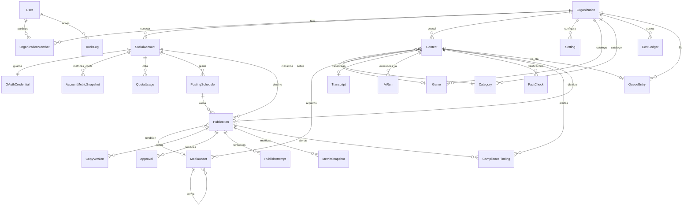

# 05 — Modelagem inicial do banco de dados

PostgreSQL 17, acessado via Prisma. Convenções:

- IDs: `uuid` v7 (ordenável por tempo) gerado pela aplicação.
- Todas as tabelas têm `createdAt`, `updatedAt` (UTC, `timestamptz`).
- Toda entidade de negócio tem `organizationId` (várias organizações no mesmo painel; `Brand` foi renomeada para `Organization` na Fase 2, [ADR 0009](adr/0009-organizacoes-e-contas.md)).
- **Fase 2 (implementada no ramo `fase-2-organizacoes`):** `Organization`, `OrganizationMember`, `SocialAccount` e `OAuthState`, descritas abaixo. As demais entidades continuam sendo o desenho das fases seguintes; onde o desenho original e o código divergem, vale o código e a nota "Fase 2" da entidade.
- Campos específicos de plataforma ficam em `jsonb` validado por schema (zod) do adaptador, para não alterar o schema a cada plataforma nova.
- Exclusão lógica (`deletedAt`) em `Content`; o resto é imutável ou histórico.
- A fila pg-boss usa seu próprio schema (`pgboss`), fora do Prisma.

## 1. Diagrama entidade-relacionamento

## 2. Tabelas

### 2.1 Identidade e organização

**User** — `id`, `email` (único), `name`, `passwordHash` (Argon2id), `totpSecretEnc` (cifrado, opcional), `role` global (`admin` | `member`), `status` (`active`|`disabled`), `lastLoginAt`.

**Session** — gerida pela biblioteca de sessão (cookie selado); se persistida: `id`, `userId`, `expiresAt`, `ip`, `userAgent`.

**Organization** (antes `Brand`; uma página/nicho) — `id`, `name`, `slug` (único), `timezone` (padrão `America/Sao_Paulo`), `locale` (`pt-BR`), `tags` (text[], tags do nicho para a IA), `voiceGuide` (texto livre), `fixedHashtags` (text[]), `creditTemplate` (padrão `Créditos: {creator}`), `captionStyle` (jsonb), `clipDefaults` (jsonb, padrão `targetMin` 5, `targetMax` 10, `minSec` 30, `maxSec` 90), `retention` (jsonb, padrão `sourceDays` 30, `unusedSourceDays` 14, `clipDays` 90), `aiMonthlyBudgetUsd` (padrão 50), `active`.

**OrganizationMember** (antes `BrandMember`) — `organizationId`, `userId`, `role` (`admin`|`editor`|`approver`|`viewer`). PK composta. Os papéis da Fase 1 valem por organização.

**Setting** — `organizationId` (nulo = global), `key`, `value` (jsonb). Ex.: horários padrão por plataforma, provedores de IA, retenção.

**Game** — `id`, `organizationId`, `name`, `slug`, `aliases` (text[]), `officialHashtags` (text[]), `externalRef` (jsonb, ex.: IGDB id — futuro).

**Category** — `id`, `organizationId`, `name`, `slug`, `kind` (`gameplay`|`curiosidade`|`noticia`|`review`|`humor`|`tutorial`|`outro`), `requiresFactCheck` (bool; `true` para notícia).

### 2.2 Contas sociais e credenciais

**SocialAccount** — `id`, `organizationId`, `platform` (`instagram`|`facebook`|`tiktok`|`youtube`), `externalId` (IG user id / Page id / TikTok open_id / YouTube channel id), `handle`, `displayName`, `avatarUrl`, `status` (`connected`|`needs_reauth`|`disconnected`|`restricted`), `grantedScopes` (text[]), `capabilities` (jsonb: ex. TikTok `privacy_level_options`, `max_video_post_duration_sec`; app auditado ou não), `connectedByUserId`, `connectedAt`, `lastHealthCheckAt`.
Único: (`platform`, `externalId`): uma conta externa só pode estar vinculada a **uma** organização ([ADR 0009](adr/0009-organizacoes-e-contas.md)).

> **Fase 2 (como está no código):** `SocialAccount` guarda `organizationId`, `platform`, `externalId`, `displayName`, `status` (`active`|`needs_reauth`), `credentialEnc` (credencial cifrada, texto único), `scopes` (text[]), `dailyLimit` (inteiro, nulo = sem limite próprio) e `connectedById`. `handle`, `avatarUrl`, `capabilities`, `connectedAt`, `lastHealthCheckAt` e a tabela `OAuthCredential` abaixo **ainda não existem**: são desenho para fases seguintes. TikTok guarda só o @ (sem credencial).

**OAuthState** (Fase 2) — `id`, `provider`, `organizationId`, `userId`, `codeVerifier`, `expiresAt`. Estado de curta duração do fluxo OAuth do YouTube (anti-CSRF e PKCE).

**OAuthCredential** — `socialAccountId` (PK/FK), `accessTokenEnc`, `refreshTokenEnc` (nulo se a plataforma não usa), `tokenType`, `accessExpiresAt`, `refreshExpiresAt`, `keyVersion` (para rotação da chave mestra), `lastRefreshedAt`, `refreshFailures`.
Os valores são cifrados com AES-256-GCM (ver [13](13-seguranca.md)). **Nunca** retornados pela API do painel.

**QuotaUsage** — `socialAccountId` (ou `platform` + projeto, para cota do YouTube que é por projeto Google), `window` (`day`/`24h-rolling`), `windowStart`, `unitsUsed`, `unitsLimit`, `source` (`api`|`estimated`). Alimentada pelo adaptador (ex.: endpoint de limite de publicação do Instagram; cálculo de unidades do YouTube).

### 2.3 Conteúdo e mídia

**Content** — `id`, `organizationId`, `title`, `categoryId`, `gameId`, `context` (texto livre do autor), `script` (roteiro opcional), `language`, `status` (ver state machine em [06](06-fluxos.md)), `contentKind` (detectado/confirmado), `rights` (jsonb: `isOriginal`, `gameplaySource`, `gameplayAuthorization`, `musicSource` (`none`|`original`|`licensed`|`platform_library`|`unknown`), `containsRealisticAi`, `notes`), `createdByUserId`, `deletedAt`.

**MediaAsset** — `id`, `contentId`, `kind` (`original`|`rendition`|`thumbnail`|`audio_extract`|`frame_sample`), `parentAssetId` (rendition → original), `storageKey` (imutável), `sha256`, `sizeBytes`, `mimeType`, `probe` (jsonb: saída normalizada do ffprobe), colunas desnormalizadas para filtro: `width`, `height`, `durationMs`, `fps`, `videoCodec`, `audioCodec`, `bitrate`; `presetId` + `presetVersion` (renditions), `strategy` (`passthrough`|`remux`|`transcode`), `status` (`pending`|`ready`|`invalid`|`expired`), `validation` (jsonb: resultado por plataforma), `expiresAt` (renditions sujeitas a retenção).
Único: (`presetId`, `presetVersion`, `parentAssetId`) — garante deduplicação de renditions idênticas.
Regra: linhas com `kind = original` **não** podem ter `storageKey` alterado (constraint/trigger).

**Transcript** — `contentId` (PK), `language`, `text`, `segments` (jsonb com timestamps), `provider`, `model`, `durationSec`, `costUsd`, `inputSha256` (do áudio).

### 2.4 IA

**AiRun** — `id`, `contentId`, `publicationId` (opcional), `task` (`analyze`|`fact_check`|`generate_copy`|`regenerate_copy`|`watermark_scan`|`weekly_insights`), `provider`, `model`, `promptId`, `promptVersion`, `inputHash` (sha256 da entrada canônica — chave de cache), `input` (jsonb, sem segredos), `output` (jsonb validado), `status` (`ok`|`invalid_output`|`refused`|`error`), `inputTokens`, `outputTokens`, `cacheReadTokens`, `cacheWriteTokens`, `costUsd`, `latencyMs`.

**FactCheck** — `id`, `contentId`, `aiRunId`, `claim`, `verdict` (`confirmed`|`unverified`|`contradicted`|`opinion`), `sources` (jsonb: url, título, trecho), `reviewedByUserId`, `reviewerVerdict`, `reviewedAt`.

### 2.5 Publicação

**Publication** — uma publicação de um conteúdo em **uma** conta social em **um** formato.
`id`, `organizationId`, `contentId`, `socialAccountId`, `platform`, `format` (`reel`|`short`|`video`|`carousel`|`image`), `mode` (`api`|`manual` — manual assistido, ver [07.0 §5](07-integracoes/00-estrategia-e-abstracao.md)), `renditionAssetId`, `status` (state machine em [06](06-fluxos.md)), `currentCopyVersionId`, `approvedCopyVersionId`, `approvedAssetId`, `scheduledAt` (UTC, nulo = imediato), `publishedAt`, `platformOptions` (jsonb validado pelo adaptador: privacidade, `share_to_feed`, `madeForKids`, `containsSyntheticMedia`, permitir dueto/stitch, categoria do YouTube etc.), `idempotencyKey` (único; = `id` por padrão), `externalId`, `externalUrl`, `progress` (jsonb: IDs intermediários — container id, upload session/URI, publish_id — persistidos **antes** do próximo passo), `attemptCount`, `nextAttemptAt`, `lastErrorCode`, `lastErrorMessage`, `lockedBy`, `lockedAt`.
Únicos: (`contentId`, `socialAccountId`, `format`) — impede duas publicações do mesmo conteúdo na mesma conta/formato (republicação exige ação explícita que cria nova linha com `supersedesId`); (`platform`, `externalId`) quando não nulo.

Campos da automação ([11 §7](11-agendamento.md)): `scheduleId` (FK `PostingSchedule`, nulo se manual), `slotAt` (horário da grade ocupado), `allocation` (`manual`|`auto`). Único parcial: (`scheduleId`, `slotAt`) quando `scheduleId` não nulo e status ≠ `canceled`.

**PostingSchedule** (grade recorrente) — `id`, `organizationId`, `socialAccountId`, `name`, `rule` (jsonb validado: `{ type: 'weekly', slots: [{ weekday: 1–7, time: 'HH:mm' }] }` ou `{ type: 'interval', everyMinutes, windowStart: 'HH:mm', windowEnd: 'HH:mm', weekdays? }`), `startsOn`, `endsOn` (opcional), `status` (`active`|`paused`), `createdByUserId`. Timezone = `Organization.timezone`.

**QueueEntry** (fila de conteúdos) — `id`, `organizationId`, `contentId` (único por organização enquanto ativo), `position` (numérico fracionário para reordenar sem renumerar), `priority` (`normal`|`urgent`), `pinnedSlotAt` (opcional, por conta em `pinnedAccountId`), `expiresAt` (opcional; padrão por categoria em `Setting`), `status` (`active`|`done`|`expired`|`removed`), `addedByUserId`. `done` quando todas as publicações aprovadas do conteúdo estão publicadas/canceladas.

**CopyVersion** — `id`, `publicationId`, `version` (int crescente), `source` (`ai`|`human`|`ai_regenerated`), `aiRunId`, `title`, `caption` (legenda/descrição), `hashtags` (text[]), `extra` (jsonb: tags do YouTube, texto de capa…), `validation` (jsonb: limites respeitados?), `createdByUserId`.

**Approval** — `id`, `publicationId`, `decision` (`approved`|`rejected`|`changes_requested`), `copyVersionId`, `assetId`, `comment`, `acceptedFindingIds` (uuid[]: alertas aceitos com justificativa), `userId`, `decidedAt`.

**PublishAttempt** — `id`, `publicationId`, `attemptNo`, `step` (`preflight`|`create_container`|`upload`|`finalize`|`poll_status`|`publish`|`reconcile`), `status` (`ok`|`transient_error`|`permanent_error`|`unknown`), `httpStatus`, `errorCode`, `errorMessage`, `requestSummary` (jsonb sem segredos), `responseSummary` (jsonb), `startedAt`, `finishedAt`.

### 2.6 Compliance, métricas, custos, auditoria

**ComplianceFinding** — `id`, `contentId`, `publicationId` (opcional), `ruleCode` (ex.: `VID_ASPECT_NOT_VERTICAL`, `POSSIBLE_FOREIGN_WATERMARK`, `MUSIC_UNKNOWN`, `UNVERIFIED_CLAIM`, `HASHTAG_LIMIT`, `DUPLICATE_UPLOAD`), `severity` (`info`|`warning`|`blocking`), `message`, `evidence` (jsonb), `status` (`open`|`resolved`|`accepted`), `resolvedByUserId`, `justification`.

**MetricSnapshot** — `id`, `publicationId`, `collectedAt`, `source` (`api`|`manual`), `ageHours` (desde a publicação), colunas comuns **anuláveis** (nulo = indisponível na plataforma, ≠ zero): `views`, `reach`, `likes`, `comments`, `shares`, `saves`, `avgWatchTimeSec`, `avgViewPercentage`, `followersGained`; `raw` (jsonb com tudo que a API devolveu, nomes originais).
Índice: (`publicationId`, `collectedAt`).

**AccountMetricSnapshot** — `socialAccountId`, `date`, `followers`, `raw` (jsonb).

**MetricDefinitionChange** — `platform`, `metric`, `effectiveAt`, `description`, `sourceUrl`. Registra mudanças de definição feitas pelas plataformas (ex.: nova contagem de views) para sinalizar nos gráficos.

**CostLedger** — `id`, `organizationId`, `category` (`llm`|`transcription`|`search`|`storage`|`other`), `provider`, `units`, `unitType` (`tokens_in`|`tokens_out`|`minutes`|`searches`…), `costUsd`, `refType` + `refId` (ex.: `AiRun`), `occurredAt`.

**AuditLog** — `id`, `organizationId`, `userId` (nulo = sistema), `action` (ex.: `publication.approved`, `account.connected`, `setting.updated`), `entityType`, `entityId`, `diff` (jsonb, sem segredos), `ip`, `at`.

### 2.7 Entidades do cortador (desenho das Fases 3 a 5; ainda não implementadas)

Delta definido na [spec §7](superpowers/specs/2026-11-17-organizacoes-e-cortador-design.md):

| Entidade | Mudança |
|---|---|
| `Brand` → `Organization`, `BrandMember` → `OrganizationMember` | Renomeadas na Fase 2, com os campos novos descritos em 2.1 |
| `SocialAccount` | Por organização, com unicidade (`platform`, `externalId`) e credencial cifrada (Fase 2) |
| `Source` (novo) | O vídeo longo: organização, tipo (`upload`/`youtube_link`), URL, `MediaAsset` original, declaração de direitos (`own`/`authorized`/`cc_license`/`clipper_program`/`none`), evidência, `partnerCreatorId?`, status do processamento ([ADR 0010](adr/0010-trava-de-direitos.md)) |
| `PartnerCreator` (novo) | Criador parceiro por organização: nome, canais, autorização |
| `ClipCandidate` (novo) | Fonte, início e fim, nota, motivo, layout, textos sugeridos, status (`suggested`/`accepted`/`rejected`/`rendered`) |
| `Clip` (novo) | Corte renderizado: candidato, `MediaAsset` por rede, hash; é a unidade que vira `Publication` |
| `Transcript`, `MediaProbe`, `AiRun`, `CostLedger`, `Publication`, `PublishAttempt`, `Approval` | Já desenhadas, reaproveitadas ([ADR 0008](adr/0008-cortador-hibrido.md)) |

## 3. Índices e restrições importantes

| Restrição | Propósito |
|---|---|
| `Publication(idempotencyKey)` único | Base da idempotência |
| `Publication(contentId, socialAccountId, format)` único | Sem publicação dupla por engano |
| `Publication(status, scheduledAt)` índice parcial `WHERE status = 'scheduled'` | Scheduler tick rápido |
| `MediaAsset(parentAssetId, presetId, presetVersion)` único | Deduplicação de renditions |
| `MediaAsset(sha256)` + `Content.organizationId` | Detecção de upload duplicado |
| `AiRun(task, inputHash, promptVersion, model)` índice | Cache de IA |
| `OAuthCredential.accessExpiresAt` índice | Job de renovação |

## 4. Retenção de dados

| Dado | Retenção |
|---|---|
| Original (`MediaAsset.kind = original`) | Indefinida (até exclusão explícita do conteúdo por admin) |
| Renditions | 30 dias após todas as publicações que as usam estarem `published`/`canceled` (regeráveis a partir do original e do preset) |
| `frame_sample`, `audio_extract` | 7 dias |
| `PublishAttempt`, `AiRun` | 18 meses |
| `MetricSnapshot` | Indefinida (volume pequeno); consolidar em diário após 90 dias se crescer |
| `AuditLog` | 24 meses |
