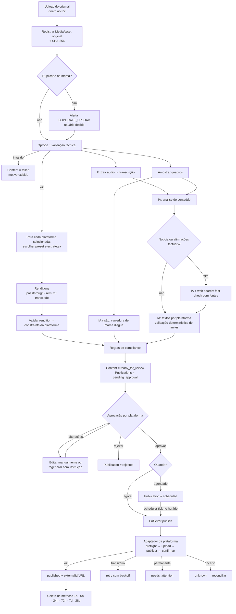
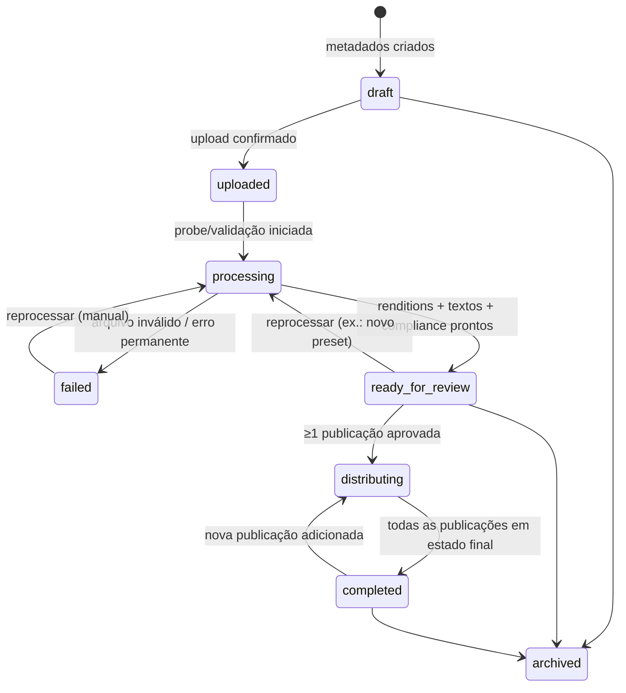
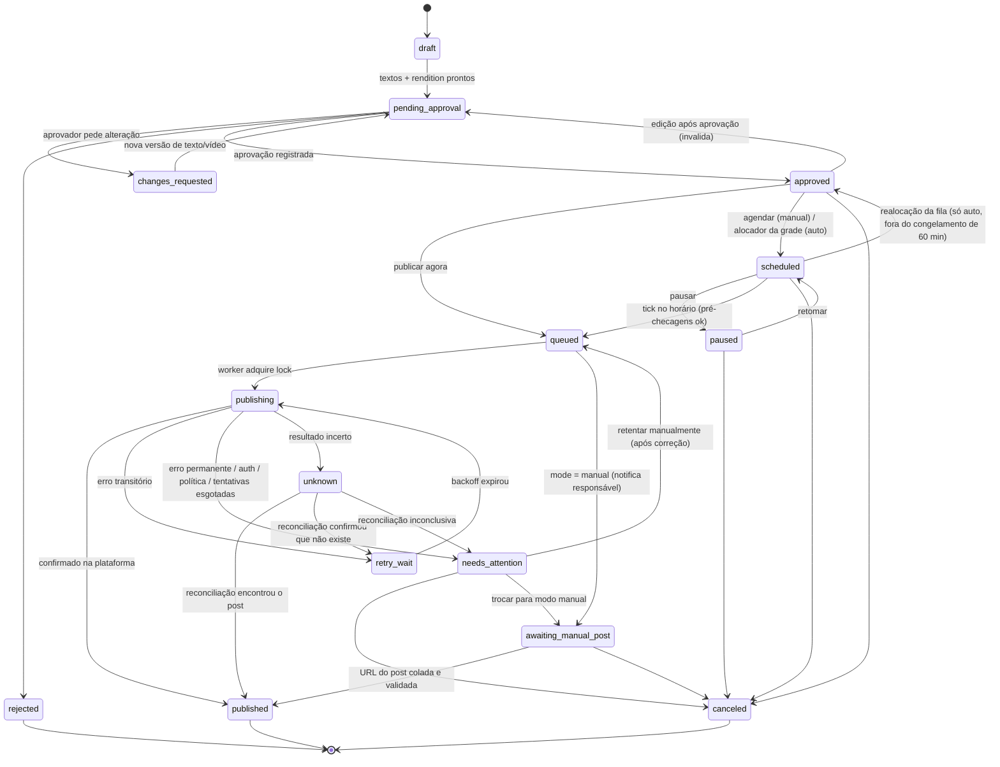
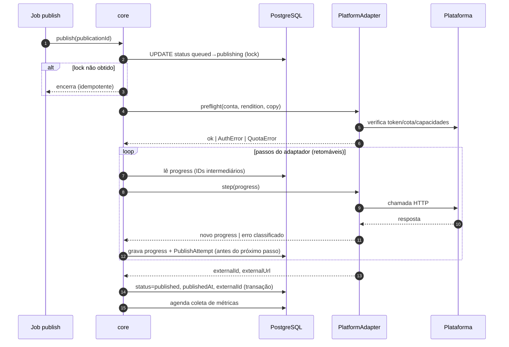
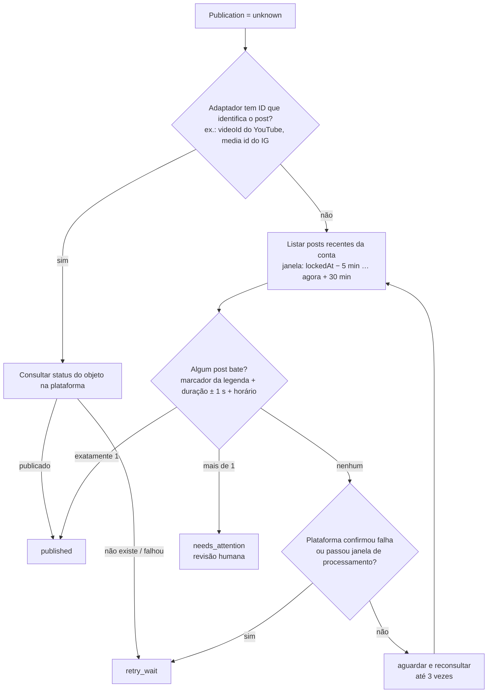
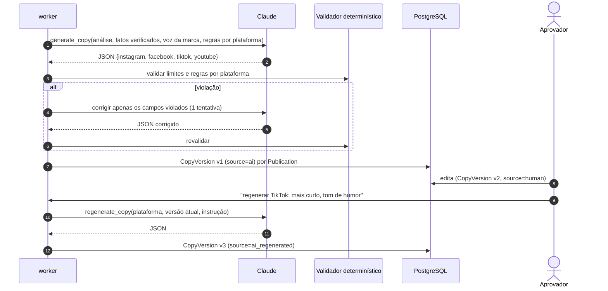
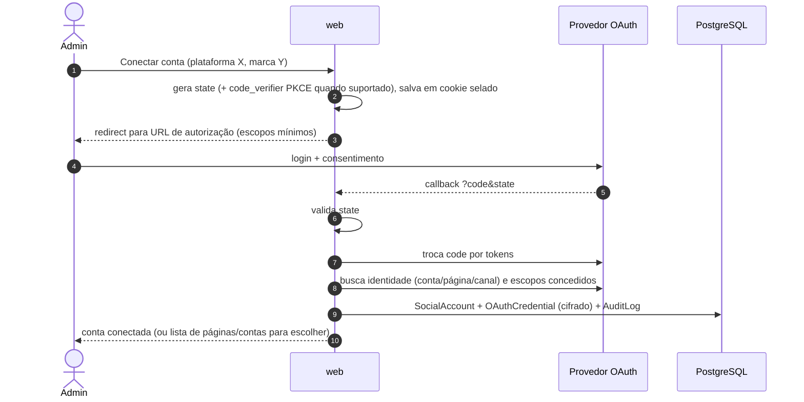
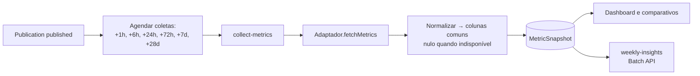

# 06 — Fluxos de processamento

## 1. Fluxo ponta a ponta

As etapas de mídia (ramo da esquerda) e de IA (ramo da direita) rodam **em paralelo** depois do ffprobe; o conteúdo só fica `ready_for_review` quando ambas terminam.

## 2. State machine do `Content`

`Content.status` é parcialmente **derivado** dos estados das publicações (`distributing`/`completed`); o `core` recalcula após cada transição de `Publication`.

## 3. State machine da `Publication` (a mais crítica)

Regras invariantes:

1. Só `approved`/`scheduled`/`needs_attention` podem ir para `queued`, e só se existir `Approval` vigente cujo `copyVersionId` = `currentCopyVersionId` e `assetId` = `renditionAssetId`.
2. A transição `queued → publishing` é um `UPDATE ... SET status='publishing', lockedBy=?, lockedAt=now() WHERE id=? AND status='queued'` — se 0 linhas, outro worker já pegou; o job termina sem efeito.
3. `published` é terminal e imutável (exceto métricas).
4. `unknown` **nunca** volta direto a `publishing` sem reconciliação.
5. Lock expirado (`lockedAt` > 15 min sem heartbeat) → job `maintenance` move para `unknown` (não para `queued`), forçando reconciliação.

## 4. Fluxo de publicação (genérico, por adaptador)

Exemplo concreto de passos (detalhes oficiais em `07-integracoes/`):

| Plataforma | Passos persistidos em `progress` |
|---|---|
| Instagram Reels | criar container → (aguardar processamento do container) → publicar container → obter permalink |
| Facebook Reels | iniciar sessão de upload → enviar bytes → finalizar/publicar → aguardar status |
| TikTok (manual assistido) | `awaiting_manual_post` → notificação no horário → pessoa baixa vídeo e copia texto → posta no app → cola URL → validação do formato da URL → `published` |
| YouTube | criar sessão resumable (URI) → enviar bytes (retomável por offset) → receber `videoId` → (opcional) thumbnail |

Se o worker morrer no meio, o próximo job lê `progress` e **continua do último passo concluído** (ex.: não cria um segundo container do Instagram se já existe um válido; retoma o upload resumable do YouTube pelo offset).

## 5. Fluxo de reconciliação (resultado incerto)

O "marcador" é um identificador **não visível**: preferencialmente um campo da própria plataforma que aceite referência externa, quando existir; caso contrário, a correspondência usa legenda exata + duração + janela de tempo. Não inserir caracteres invisíveis na legenda (pode ser interpretado como manipulação).

## 6. Fluxo de geração e revisão de textos

## 7. Fluxo de conexão de conta (OAuth genérico)

## 8. Fluxo de coleta de métricas

Após 28 dias: coleta semanal até 90 dias, depois mensal (configurável). Respeita limites de taxa de cada plataforma (fila `metrics` com concorrência baixa).
