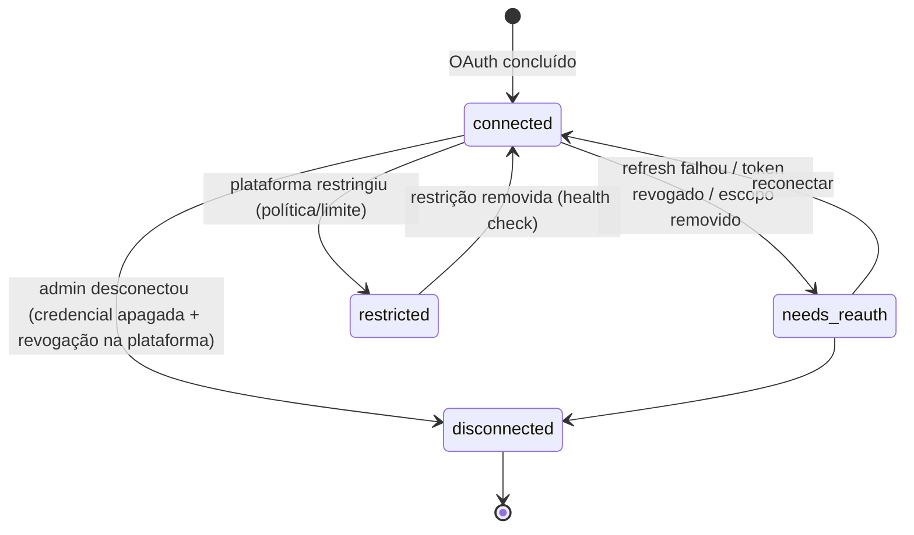

# 08 — Autenticação e autorização

Dois mundos distintos:

1. **Usuários internos → painel** (quem pode fazer o quê na central). Detalhado em [13 §3](13-seguranca.md).
2. **Central → plataformas sociais** (OAuth, tokens, escopos, aprovação de apps). Detalhado aqui, com base nas análises em `07-integracoes/`.

## 1. Painel (resumo)

- E-mail + senha (Argon2id), convite pelo admin, 2FA TOTP obrigatório para `admin`/`approver`.
- Sessão em cookie selado (`nuxt-auth-utils`), 12 h deslizante.
- Papéis por organização (`OrganizationMember.role`): `viewer`, `editor`, `approver`, `admin`. Checagem no servidor em toda rota.
- Login social (Google Workspace) é opcional futuro; não necessário para poucos usuários.

## 2. Apps de desenvolvedor necessários (um de cada, para toda a operação)

| Plataforma | App/projeto | Dono recomendado | Observação |
|---|---|---|---|
| Meta (IG + FB) | 1 app Meta do tipo **Business**, pertencente ao **Business Manager** da marca (onde já estão o IG profissional e a Página, com o IG vinculado à Página) | Business Manager do dono | Mesmo app **e mesmo System User** atendem Instagram e Facebook |
| YouTube | 1 projeto Google Cloud com YouTube Data API v3 + YouTube Analytics API | Conta Google dona do canal | Políticas exigem **um projeto por cliente de API** → todos os canais futuros compartilham a cota do projeto |
| TikTok | **Nenhum** (manual assistido — ADR 0004) | — | Reavaliar a API for Business se a empresa atender os requisitos de registro |

Credenciais dos apps (client id/secret, app secret) ficam em variáveis de ambiente; tokens de contas ficam cifrados no banco ([13 §2](13-seguranca.md)).

## 3. Meta — Instagram e Facebook

### 3.1 Instagram

Fonte: [instagram.md](07-integracoes/instagram.md) §3–4.

| Item | Decisão / fato |
|---|---|
| Variante de API | **Instagram API with Facebook Login, com token do mesmo System User do Facebook** (decisão: IG e Página já estão no mesmo Business Manager e o IG está vinculado à Página → um único token/cofre para as duas redes; upload resumable disponível). Alternativa avaliada e não adotada: Unified Login (recomendada pela Meta para novas integrações, mas recente e com lacunas na doc; reavaliar se a Meta lançar recursos só nela). Instagram Login descartado (sem upload resumable documentado) |
| Tipo de conta | Profissional (Business ou Creator) |
| Aprovação | Uso interno com usuários que têm papel no app/portfólio → **Standard Access, App Review não exigido** (✅ documentado). Advanced Access/App Review/Business Verification só se atender contas de terceiros |
| Validação obrigatória na PoC | (1) post feito com o app em modo desenvolvimento fica **público**? (2) token do System User obtém o IG vinculado à Página e publica Reel via upload resumable |
| Escopos | Os mínimos para publicar conteúdo e ler insights da variante escolhida — nomes exatos em [instagram.md](07-integracoes/instagram.md) §3 |

### 3.2 Facebook (Página)

Fonte: [facebook.md](07-integracoes/facebook.md) §3–4.

| Item | Decisão / fato |
|---|---|
| Identidade técnica | **System User** do Business Manager (sem depender da conta pessoal de alguém), com acesso atribuído à(s) Página(s) |
| Token | System User token (preferir o de 60 dias com rotação, recomendado pela Meta; não expirante é alternativa) → `me/accounts` devolve Page tokens por Página |
| Permissões | `pages_show_list`, `pages_read_engagement`, `pages_manage_posts` (publicar Reels); `read_insights` (+ permissão de engajamento conforme doc) para métricas; tarefas `CREATE_CONTENT` e `ANALYZE` na Página |
| Aprovação | Usuários com papel no app → Standard Access sem App Review (✅). ❓ Confirmar: conteúdo publicado com app em modo desenvolvimento fica visível ao público? Exigência de Standard Access à Marketing API para gerar token de System User |

### 3.3 Renovação

- Job `token-refresh` (1/h) renova tokens que expiram em < 7 dias (Meta, quando aplicável).
- Falha de renovação → `SocialAccount.status = needs_reauth` + alerta + pré-checagem bloqueia publicações agendadas daquela conta.

## 4. YouTube

Fonte: [youtube.md](07-integracoes/youtube.md) §2–4.

| Item | Decisão / fato |
|---|---|
| Fluxo | OAuth 2.0 para aplicações web server, `access_type=offline` para obter refresh token; PKCE recomendado |
| Escopos | `youtube.upload` (upload), `youtube.readonly` (ler vídeos/estatísticas), `yt-analytics.readonly` (Analytics). Evitar o escopo amplo `youtube` se não houver necessidade de editar/apagar |
| Conta e canal (decisão — ADR 0006) | **Canal de marca (Brand Account)** cujo dono é um **Gmail dedicado** à operação (não pessoal), com verificação em duas etapas, acesso guardado no gerenciador de senhas da equipe; canal verificado por telefone (libera thumbnails personalizadas e vídeos > 15 min); membros da equipe como gerentes |
| Tela de consentimento | App *External* colocado **In production** (em *Testing* o refresh token expira em 7 dias ✅). Escopos `youtube.*` são sensíveis → validar com o teste de 8 dias (H6) antes da Fase 6. **Plano B** se o token expirar ou a verificação for exigida: transferir a propriedade do canal de marca para uma conta Google Workspace e usar app *Internal* (sem perder vídeos nem inscritos), ou solicitar verificação do app (prazo imprevisível) |
| Auditoria | Desde 02/11/2026 projetos não verificados **não** ficam mais presos em "privado" (✅). Auditoria de compliance só para aumento de cota |
| Cota | Bucket de uploads: 100 `videos.insert`/dia por projeto; demais métodos: 10.000 unidades/dia |
| Políticas que impactam o produto | Humano com controle final e consentimento explícito para ações automatizadas (a central já exige aprovação); não alterar metadados sem consentimento; dados autorizados armazenados devem ser atualizados ou apagados a cada 30 dias (ver [16](16-riscos-e-limitacoes.md)) |

## 5. TikTok

**Decisão atual: sem integração por API — modo manual assistido (ADR 0004).** Não há credenciais do TikTok no sistema. A tabela abaixo fica como referência para uma futura reavaliação.

Fonte: [tiktok.md](07-integracoes/tiktok.md).

| Item | Fato |
|---|---|
| Content Posting API | Login Kit OAuth v2 (com PKCE para web conforme doc); escopos `user.info.basic`, `video.publish` (Direct Post) e/ou `video.upload` (inbox), `video.list` (leitura) |
| Tokens (Content Posting API) | Access token de curta duração e refresh token **rotativo** (cada renovação devolve um novo refresh token) → renovação com **trava por conta**; usar sempre a validade retornada na resposta |
| Aprovação | Revisão do app + **auditoria** para posts públicos; antes da auditoria, posts só `SELF_ONLY`, conta privada, poucos usuários |
| Restrição de política | Diretrizes indicam que ferramentas para contas que a própria equipe gerencia e apps de uso privado não são aceitos → **ponto de decisão** ([07.0 §4](07-integracoes/00-estrategia-e-abstracao.md)) |
| **Rota recomendada** | **TikTok API for Business — Accounts API** (conta própria): registro do desenvolvedor como **empresa** (e-mail corporativo + site), app declarado para uso organizacional interno, revisão (2–3 dias úteis) + formulário de acesso à Accounts API; código de autorização 10 min, access token 1 dia, refresh token 1 ano; detalhes e escopos em [tiktok.md](07-integracoes/tiktok.md) §17 |
| UX obrigatória (só Content Posting API) | No momento de postar: exibir a conta de destino (nome/avatar atualizados via `creator_info`), privacidade escolhida pelo usuário **sem valor padrão**, toggles de interação, divulgação de conteúdo comercial e consentimento. Na Accounts API o post é sempre público e esses requisitos não estão documentados |

## 6. Ciclo de vida de uma conta conectada

Health check diário por conta: valida token, escopos concedidos, capacidades (ex.: limite de publicação do Instagram, `creator_info` do TikTok) e atualiza `SocialAccount.capabilities`.

## 7. Checklist de credenciais por fase

| Fase | Ação de setup (fora do código) |
|---|---|
| 5 | App Meta Business criado no Business Manager existente; System User com acesso à Página e ao IG; app em modo adequado; PoC dos pontos ❓ |
| 6 | Gmail dedicado + canal de marca verificado (feito na trilha da Fase 1); projeto Google Cloud; APIs habilitadas; consent screen *External / In production*; teste de refresh após 8 dias |
| 7 | Nenhum (TikTok manual) |
