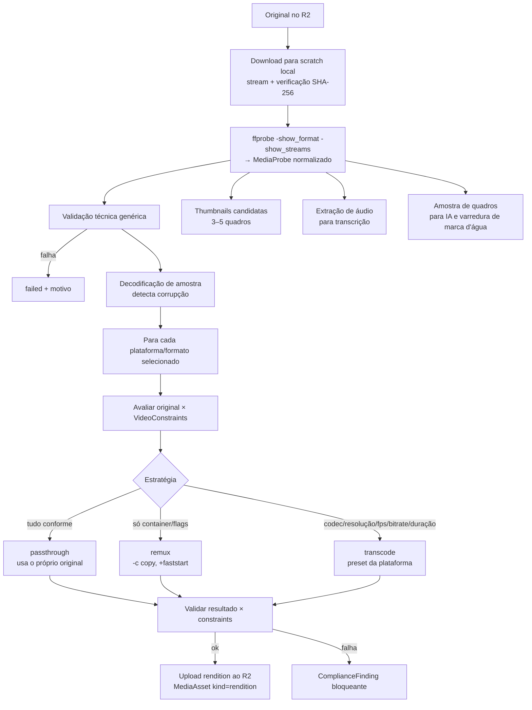

# 10 — Pipeline de processamento audiovisual

## 1. Objetivos

1. **Preservar o original** — nunca modificado; renditions são arquivos novos.
2. **Evitar recompressão desnecessária** — reaproveitar, depois remux, só então transcode.
3. **Validar individualmente por plataforma** — cada adaptador declara suas `VideoConstraints` com base nas especificações oficiais (ver `07-integracoes/<plataforma>.md`). Nada de assumir que todas aceitam os mesmos parâmetros.
4. **Sem marca d'água de uma rede na versão de outra** — a central não aplica marcas; detecta suspeitas no original.
5. **Reprodutível** — presets versionados; mesmo original + mesmo preset = mesmo resultado (e reaproveitado).

## 2. Etapas



## 3. `MediaProbe` (campos normalizados)

| Campo | Origem ffprobe | Observação |
|---|---|---|
| `container` | `format.format_name` | mp4/mov/webm/mkv |
| `durationMs` | `format.duration` | — |
| `sizeBytes` | `format.size` | — |
| `bitrate` | `format.bit_rate` | total |
| `video.codec` / `profile` / `level` | stream de vídeo | h264, hevc, vp9, av1 |
| `video.width` / `height` | stream | **após aplicar rotação** (`side_data` displaymatrix / tag `rotate`) |
| `video.displayAspect` | calculado | ex.: 0.5625 (9:16) |
| `video.fps` / `isVfr` | `avg_frame_rate` vs `r_frame_rate` | VFR comum em gravações de celular/captura |
| `video.pixFmt` / `bitDepth` / `colorTransfer` | stream | detecta HDR (PQ/HLG) e 10 bits |
| `video.bitrate` | stream | — |
| `audio.codec` / `sampleRate` / `channels` / `bitrate` | stream de áudio | ausência de áudio é permitida, mas alertada |
| `faststart` | posição do átomo `moov` | — |
| `tags` | `format.tags` | encoder, comentários — usados na heurística de origem/marca d'água |

## 4. Validação técnica genérica (antes de qualquer plataforma)

| Regra | Severidade |
|---|---|
| Arquivo com stream de vídeo decodificável | bloqueante |
| Container entre mp4/mov/webm/mkv | bloqueante |
| Duração ≥ 3 s e ≤ 60 min | bloqueante |
| Resolução mínima 540 px no menor lado | aviso (pode ser bloqueante para alguma plataforma) |
| Sem áudio | aviso |
| Áudio com pico/loudness extremo (medido com `ebur128`) | aviso |
| Proporção não vertical (≠ 9:16 ± 1%) | aviso (bloqueante para formatos verticais se o usuário não escolher pad/crop) |
| HDR / 10 bits | aviso (transcode para SDR 8 bits nos perfis que exigem) |
| Tags de encoder/comentário indicando download de outra rede | aviso `POSSIBLE_FOREIGN_ORIGIN` |

## 5. `VideoConstraints` por plataforma

Cada adaptador exporta um objeto de restrições **preenchido a partir da documentação oficial**, com a fonte e a data, por exemplo:

```
VideoConstraints {
  containers, videoCodecs, audioCodecs,
  minWidth, minHeight, recommendedWidth, recommendedHeight,
  aspectRatios (lista com tolerância),
  minDurationSec, maxDurationSec,
  minFps, maxFps,
  maxFileSizeBytes, maxVideoBitrate?, audioSampleRates?,
  requiresFaststart?,
  source: { url, retrievedAt }
}
```

Valores atuais por plataforma estão nas análises: [instagram.md](07-integracoes/instagram.md), [facebook.md](07-integracoes/facebook.md), [tiktok.md](07-integracoes/tiktok.md), [youtube.md](07-integracoes/youtube.md). Exemplo relevante já confirmado: **Facebook Reels via API aceita 3–90 s**, 9:16, 24–60 fps, H.264/H.265 + AAC 48 kHz — logo um vídeo de 2 min **não** pode ir como Reel do Facebook; o sistema deve bloquear a seleção (ou sugerir outro formato) já na criação da publicação.

Os valores **mudam**: o teste de contrato da Fase 3 inclui uma checklist de revisão das constraints a cada trimestre (ver [16](16-riscos-e-limitacoes.md)).

## 6. Decisão de estratégia

```
para cada (plataforma, formato):
  c = adapter.constraints(formato)
  violações = comparar(probe, c)
  se violações vazio:
      se probe.container == mp4 e faststart: passthrough
      senão: remux
  se violações ⊆ {container, faststart, tags}: remux
  senão: transcode com preset(plataforma, formato)
```

- **Passthrough** não cria arquivo novo: a `Publication` aponta para o original (que nunca é alterado). Isso é seguro porque a publicação só lê.
- **Remux:** `-map 0 -c copy -movflags +faststart` (remove metadados de origem com `-map_metadata -1` quando configurado).
- **Deduplicação:** se dois destinos resultam no mesmo `presetId@version`, gera-se uma única rendition (`MediaAsset` com unique `(parentAssetId, presetId, presetVersion)`).

## 7. Presets de transcode (ponto de partida — ajustar às specs oficiais)

| Parâmetro | Vertical 1080p padrão (`vertical-1080-h264@1`) |
|---|---|
| Vídeo | H.264 High, `yuv420p`, 8 bits, SDR (BT.709) |
| Resolução | 1080x1920; manter se já for; reduzir se maior; **nunca aumentar** além do original sem decisão explícita |
| Escala | `scale` com `force_original_aspect_ratio=decrease` + (pad ou crop apenas se o usuário escolheu) |
| FPS | Preservar original se dentro de [min,max] da plataforma; senão o valor permitido mais próximo (30 ou 60); VFR → CFR |
| Qualidade | CRF 18–20, `preset slow`, com `maxrate`/`bufsize` limitados ao máximo da plataforma |
| GOP | keyframe a cada 2 s (`-g 2*fps`), `-sc_threshold 0` opcional |
| Áudio | AAC-LC, 48 kHz, estéreo, 128–192 kbps; se o original já for AAC conforme → copiar o áudio (`-c:a copy`) |
| Container | MP4, `+faststart` |
| Metadados | `-map_metadata -1` (remove tags de origem), mantém rotação aplicada |

Variantes: `square-1080-h264@1` (1080x1080, para YouTube Shorts quadrado ou carrossel futuro), `vertical-720-h264@1` (fallback se o limite de tamanho for apertado).

**Não horizontais:** se o original for 16:9 e o destino exigir vertical, a UI oferece: (a) não publicar naquela rede; (b) pad com fundo desfocado; (c) crop central. A escolha fica gravada no preset da publicação. Nunca automático.

## 8. Thumbnails e capas

- 3–5 quadros candidatos (ex.: 10%, 25%, 50% da duração + detecção de cena com `select='gt(scene,0.4)'`), JPEG 1080x1920.
- Quem suporta capa via API (ver análises por plataforma) recebe a escolhida; quem não suporta, ignora.
- O offset (ms) da capa escolhida também é guardado, porque algumas APIs recebem tempo, não imagem.

## 9. Varredura de marca d'água / origem

1. **Metadados:** tags de encoder e comentários do container que indiquem origem em outra rede.
2. **Visual:** 6 quadros (início/meio/fim + recortes ampliados dos cantos) → modelo de visão barato (`claude-haiku-5-5`) com saída estruturada → `POSSIBLE_FOREIGN_WATERMARK` (aviso; bloqueante se confiança alta, com aceite justificado possível).
3. **Declaração** do usuário no upload (é original? fonte do gameplay? música?).

Limitação: heurística, com falsos positivos (HUD de jogos, logos de publishers) e falsos negativos. Não substitui a responsabilidade editorial.

## 10. Execução, recursos e falhas

| Aspecto | Decisão |
|---|---|
| Concorrência | Fila `media` com 1 job simultâneo por padrão (configurável); FFmpeg com `-threads` = vCPUs − 1 |
| Scratch | Diretório por job (`/scratch/<jobId>`), removido em `finally`; checagem de espaço livre antes de iniciar |
| Timeout | Proporcional à duração (ex.: 10× a duração + 2 min); processo morto e job falha como transitório |
| Progresso | Parse de `-progress pipe:1` → percentual salvo a cada 5 s para a UI |
| Logs | Comando (argumentos), versão do FFmpeg, duração, stderr resumido em caso de erro — gravados no histórico de processamento |
| Retry | 2 tentativas para erros transitórios (I/O, storage); erros de decodificação são permanentes |
| Segurança | Argumentos via array (sem shell); arquivos de entrada só do próprio storage; limites de tamanho; FFmpeg roda como usuário sem privilégios no container |

## 11. Testes do pipeline

Biblioteca de vídeos de amostra (gerados com FFmpeg `testsrc`/`sine`, sem direitos autorais): vertical H.264 conforme (espera passthrough), MOV sem faststart (remux), HEVC 10 bits HDR (transcode SDR), 60 fps VFR (CFR), 4K vertical (downscale), horizontal 16:9 (exige escolha), sem áudio, arquivo truncado (falha), duração 2 min (bloqueio para Facebook Reels). Testes verificam a estratégia escolhida e validam a saída com ffprobe contra as constraints.
