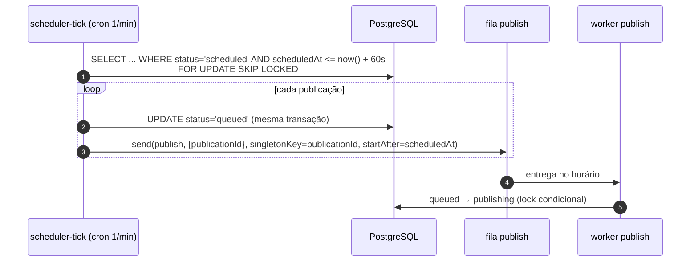
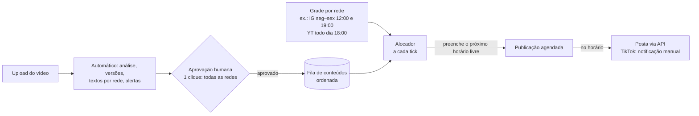

# 11 — Estratégia de agendamento

## 1. Princípios

1. **O banco é a fonte da verdade.** Um agendamento é `Publication.status = 'scheduled'` + `scheduledAt` (UTC). A fila apenas executa.
2. **Horário por publicação**, portanto horário diferente por rede é natural.
3. **Timezone por organização** (`Organization.timezone`, padrão `America/Sao_Paulo`). A UI converte; o banco guarda UTC. Usar biblioteca de timezone com base IANA (ex.: `Temporal` polyfill ou `date-fns-tz`); nunca offsets fixos (o Brasil já teve e pode voltar a ter horário de verão).
4. **Agendamento próprio, não nativo da plataforma** (decisão inicial). Motivos: um único mecanismo para as 4 redes; pausar/cancelar/editar funciona igual em todas; a aprovação e as pré-checagens acontecem perto do horário. Agendamento nativo (quando a API oferece, ex.: YouTube `publishAt`) fica como opção futura por adaptador — documentado em `07-integracoes/`.

## 2. Mecanismo



- **Redundância intencional:** ao agendar, o `web` já cria o job com `startAfter = scheduledAt` (`singletonKey = publicationId`). O *tick* é a rede de segurança: se o job sumir (restore de backup, falha), o tick recria. `singletonKey` evita jobs duplicados; o lock condicional evita execução dupla.
- **Pré-checagens T-30 min** (job `preflight-scheduled`): token válido (renova se preciso), cota prevista disponível, rendition existe no storage, aprovação vigente, conta não está `needs_reauth`. Falha → alerta imediato para dar tempo de corrigir antes do horário.

## 3. Operações

| Operação | Efeito |
|---|---|
| Publicar agora | `approved → queued`; job imediato |
| Agendar | `approved → scheduled`, `scheduledAt` definido; job com `startAfter` |
| Reagendar (arrastar no calendário) | Atualiza `scheduledAt`; cancela job antigo (por `singletonKey`) e cria novo; permitido em `scheduled`/`paused` |
| Pausar | `scheduled → paused`; o job, se disparar, encontra status ≠ `queued` e encerra sem efeito |
| Retomar | `paused → scheduled`; se `scheduledAt` já passou, pergunta: publicar agora ou escolher novo horário |
| Cancelar | `scheduled|paused|approved → canceled` |
| Pausa global (botão de emergência) | `Setting publishing.paused = true` → worker de publish não adquire locks; agendamentos vencidos ficam aguardando e são listados ao retomar |
| Retentar falha | `needs_attention → queued` após o usuário confirmar (com o erro exibido) |

## 4. Janelas e limites

| Regra | Detalhe |
|---|---|
| Atraso máximo tolerado | Se o worker esteve fora e o horário passou há mais de `lateThreshold` (padrão 2 h), **não publicar automaticamente**: marcar `needs_attention` com motivo `MISSED_WINDOW` e pedir decisão |
| Espaçamento mínimo por conta | Configurável (ex.: 2 h entre posts na mesma conta) — alerta no calendário se violado |
| Limites diários das plataformas | O agendador consulta `QuotaUsage` previsto do dia e alerta se o dia agendado ultrapassar o limite conhecido da plataforma (ex.: limite de posts por 24 h do Instagram, cota diária do YouTube) |
| Horários padrão | `Setting schedule.defaults[platform]` (ex.: IG 19:00, TikTok 20:00) para pré-preencher |

## 5. Calendário editorial (UI)

```
┌───────────── Novembro 2026 ───── [Mês] [Semana] ── Filtro: [IG][FB][TT][YT] ┐
│ Seg 16            │ Ter 17             │ Qua 18            │ ...            │
│ ● IG 19:00 Elden… │ ● TT 20:00 Top 5…  │ ⚠ YT 18:00 Notí…  │                │
│ ● YT 19:30 Elden… │ ⏸ FB 21:00 Top 5…  │   (cota no limite)│                │
└──────────────────────────────────────────────────────────────────────────────┘
● agendado   ⏸ pausado   ✔ publicado   ✖ falhou   ⚠ alerta
```

Arrastar e soltar reagenda (com confirmação), clique abre o editor da publicação.

## 6. Critérios de verificação

- Agendar para daqui a 2 min → publicação inicia em até 2 min após o horário.
- Matar o worker antes do horário, religar 1 min depois do horário → publica uma única vez.
- Apagar a tabela de jobs do pg-boss com agendamentos pendentes → o tick recria e publica no horário.
- Pausar 1 min antes → não publica; retomar após o horário → sistema pergunta o que fazer.
- Mudar o timezone da organização → horários exibidos mudam, instantes em UTC permanecem.

## 7. Grade recorrente e fila automática ("piloto automático")

> Pedido do dono do produto (2026-11-15): automatizar ao máximo a postagem. Ele define no calendário **de quanto em quanto tempo** postar em cada rede, e a central **pega o próximo conteúdo e posta sozinha**. Decisão registrada em [ADR 0007](adr/0007-grade-recorrente-e-fila.md).

### 7.1 Ideia



- O **único passo humano** é revisar e aprovar cada conteúdo, uma vez, com um clique para todas as redes (RF-APR-08). Tudo antes (versões, textos) e depois (agendar, postar, coletar métricas) é automático.
- A aprovação **não** pode ser removida:
  - publicar sem aprovação é um anti-objetivo ([00 §6](00-visao-geral.md));
  - as políticas da API do YouTube exigem controle humano final ([08 §4](08-autenticacao-autorizacao.md));
  - um post errado pode prejudicar a monetização.

  Para reduzir o esforço, a aprovação pode ser feita **em lote** (ex.: domingo, aprovar os vídeos da semana) e a fila vai sendo consumida sozinha.

### 7.2 Grade de publicação (`PostingSchedule`)

Uma grade por conta social. Tipos de regra:

| Tipo | Exemplo | Campos |
|---|---|---|
| Semanal | IG: seg–sex às 12:00 e 19:00; sáb 15:00 | dias da semana × horários |
| Intervalo | YT: a cada 8 h entre 09:00 e 23:00 | intervalo em horas + janela diária |

- Horários no timezone da organização. Os instantes gerados são guardados em UTC.
- Pode ter início, fim e pausa (pausar a grade não afeta publicações agendadas à mão).
- Na criação, o painel **valida a grade** contra o espaçamento mínimo e os limites diários conhecidos da plataforma (§4). Uma grade que gera mais posts por dia do que o limite é recusada.
- A frequência é escolha editorial. A central não sugere números até haver histórico (sugestão por desempenho: RF-AGE-06, Fase 10).

### 7.3 Fila de conteúdos (`QueueEntry`)

- Um conteúdo entra na fila quando ao menos uma das suas publicações é aprovada (opção da organização, padrão ligado).
- **Ordem:**
  1. itens **fixados** num horário específico;
  2. **prioridade** (`urgent`, por exemplo uma notícia quente, ou `normal`);
  3. posição manual (arrastar na lista).
- **Cada rede tem seu próprio cursor.** Cada horário da grade de uma conta pega o **primeiro conteúdo da fila que ainda tem publicação aprovada e não publicada para aquela conta**. Assim, cada vídeo percorre naturalmente todas as redes, cada uma no seu ritmo.
- **Elegibilidade por rede:** um conteúdo inelegível para uma conta (ex.: > 90 s no Facebook, ou sem publicação aprovada para ela) é pulado só naquela rede e continua na fila para as outras.
- **Validade:** cada item pode ter `expiresAt`. Para a categoria "notícia" o padrão é configurável (sugestão inicial: 48 h após a aprovação). Um item vencido não é postado: sai da fila com alerta. Isso evita postar notícia velha, o que prejudica alcance e credibilidade.
- Nunca recicla conteúdo já publicado na mesma conta (`ALREADY_PUBLISHED_ON_ACCOUNT`, [18](18-originalidade-e-politicas.md)). Fila vazia significa que **nada** é postado, nunca repost.

### 7.4 Alocador

Roda dentro do `scheduler-tick` (1/min). Também roda imediatamente quando a fila ou uma grade muda.

1. Para cada grade ativa, gera os horários dos próximos **7 dias** (horizonte configurável).
2. Para cada horário ainda sem publicação, escolhe o próximo item elegível (§7.3) e, **na mesma transação**:
   - muda a publicação de `approved` para `scheduled`;
   - grava `scheduledAt` = horário, `scheduleId` e `allocation = auto`;
   - cria o job com `startAfter`.
3. **Congelamento:** publicações automáticas com horário a menos de **60 min** (antes da pré-checagem T-30) não mudam mais. Fora dessa janela, reordenar a fila **realoca**: as publicações automáticas futuras voltam para `approved` e são redistribuídas. Publicações agendadas à mão (`allocation = manual`) nunca são mexidas pelo alocador.
4. Unicidade: `(scheduleId, slotAt)` impede dois posts no mesmo horário da grade, mesmo com dois ticks concorrentes (`FOR UPDATE SKIP LOCKED` + constraint única).

### 7.5 Alertas da automação

| Alerta | Quando |
|---|---|
| `QUEUE_LOW` | A fila aprovada cobre menos de **3 dias** de horários de alguma rede (configurável): "aprove mais conteúdos" |
| `SLOT_UNFILLED` | Chegou a T-60 min e o horário ficou vazio (o horário é pulado) |
| `QUEUE_ITEM_EXPIRED` | Item com validade venceu sem ser publicado |
| `SCHEDULE_EXCEEDS_LIMIT` | Grade ultrapassa limite diário ou espaçamento (na criação e se o limite da plataforma mudar) |

Os demais comportamentos (pré-checagem T-30, `MISSED_WINDOW`, pausa global, retentativas) valem igualmente para publicações alocadas pela grade.

### 7.6 TikTok (manual assistido)

Os horários da grade do TikTok geram publicações `mode = manual`. No horário, o responsável recebe a notificação com o link (download do vídeo + texto pronto) e cola a URL depois ([ADR 0004](adr/0004-tiktok-manual-assistido.md)). Se a URL não for colada em **6 h** (configurável), um alerta lembra. O próximo horário do TikTok não espera o anterior.

### 7.7 Critérios de verificação

- Grade IG "todo dia 19:00" + 3 conteúdos aprovados na fila → próximos 3 dias preenchidos em ordem, visíveis no calendário.
- Conteúdo de 2 min na fila + grades IG e FB → vai para o IG e é pulado no FB, onde o próximo conteúdo elegível ocupa o horário.
- Reordenar a fila → horários além de 60 min trocam de conteúdo; horário a 30 min não muda.
- Item urgente → ocupa o próximo horário não congelado de cada rede.
- Fila vazia → nenhum post; alertas `QUEUE_LOW` e depois `SLOT_UNFILLED`.
- Notícia com validade vencida → não é postada; alerta `QUEUE_ITEM_EXPIRED`.
- Dois ticks simultâneos → um único post por horário (teste de concorrência).
- Editar o texto de uma publicação alocada → aprovação invalidada (RF-APR-04); a publicação sai do horário e o alocador põe o próximo item.
